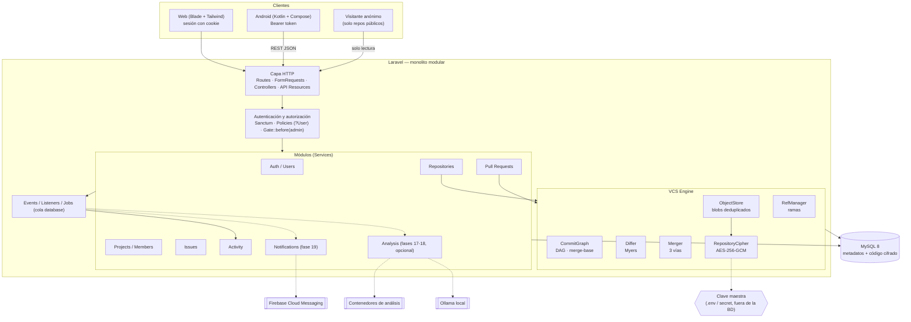
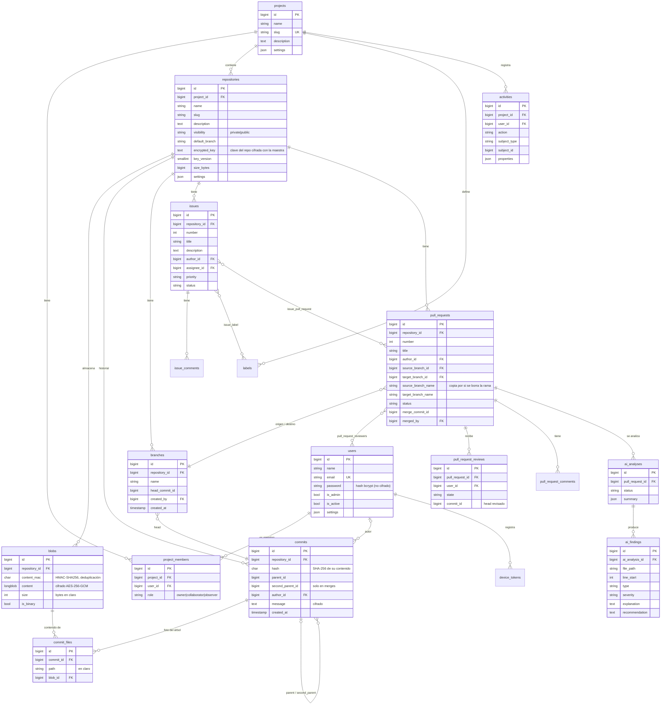
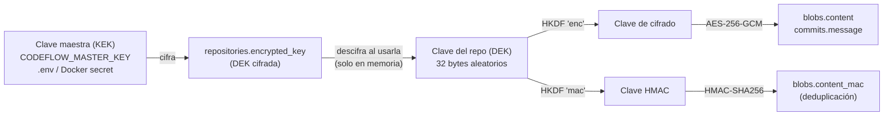
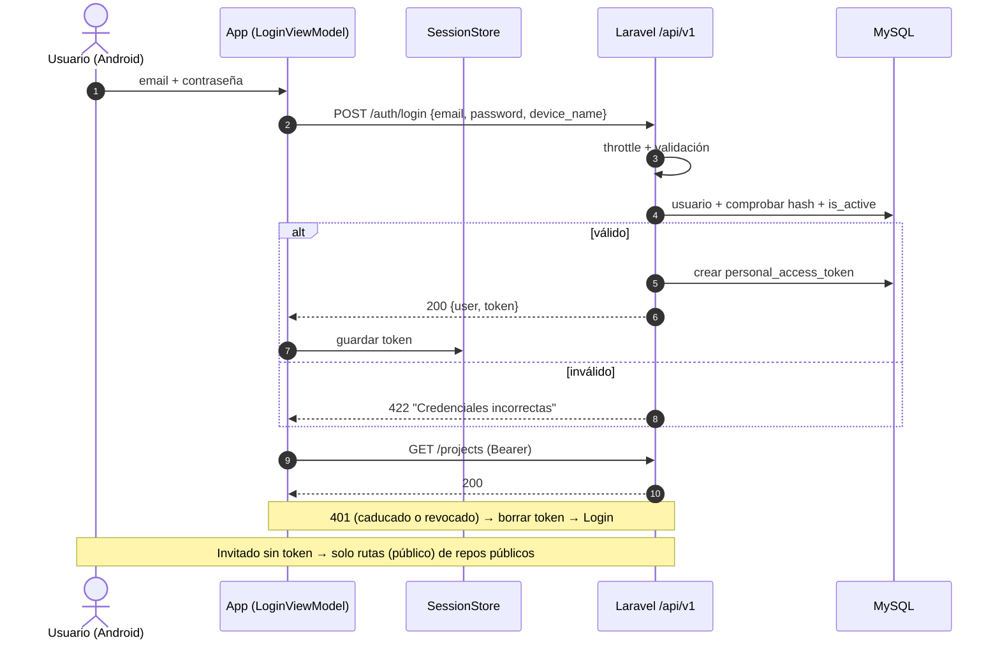
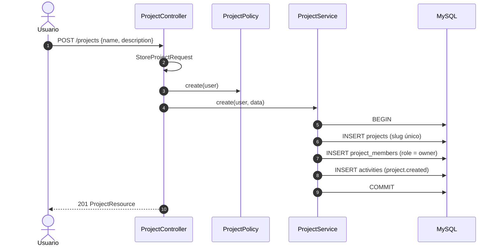
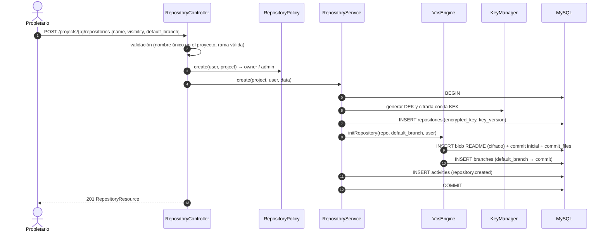
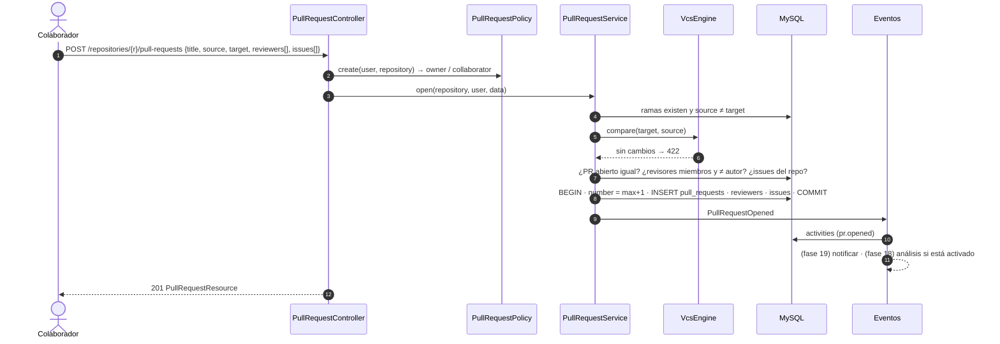
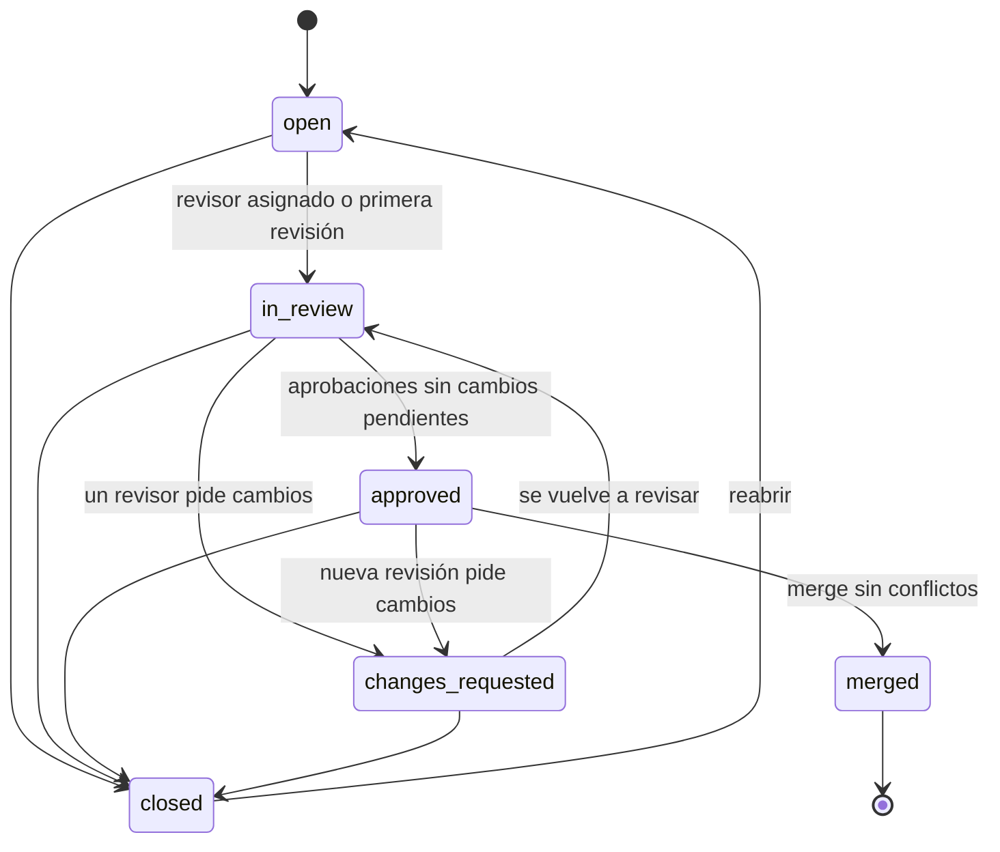
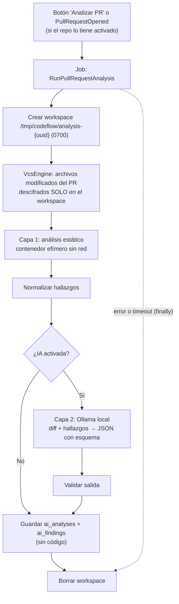

# CodeFlow — Propuesta de arquitectura (Fase 0)

> Estado: **aprobada e implementada (MVP web + API)**. La app Android está en fase de esqueleto.
> Versión 2 — 8 de octubre de 2026. Cambio principal respecto a la v1: **CodeFlow tiene su propio sistema de control de versiones** (no usa Git) y **los repositorios se cifran**.

---

## 0. Decisiones tomadas y problemas detectados

### 0.1 Decisiones confirmadas

| # | Decisión | Elección |
|---|---|---|
| D1 | Control de versiones | **Motor propio (VCS Engine)** inspirado en Git. Todo se guarda en MySQL: usuarios, proyectos, repositorios, archivos, commits y ramas |
| D2 | Cifrado | **Una clave por repositorio** (AES-256-GCM), guardada cifrada con una **clave maestra** que no está en la BD |
| D3 | Qué se cifra | **Contenido de los archivos y mensajes de commit.** Las rutas y nombres de archivo quedan en claro (compromiso documentado en §9.6) |
| D4 | Visibilidad | Repositorios **privados** (solo miembros) o **públicos** (lectura **sin login**; para escribir hace falta ser miembro) |
| D5 | Web | **Blade + Tailwind**, reutilizando los mismos Services y Policies que la API |
| D6 | Código existente | **Se reaprovecha.** El repositorio actual ya sigue este enfoque (`VcsService` + tablas `blobs`, `commits`, `commit_files`, `branches`) y se mejora |

> ⚠️ La especificación del chat decía "NO implementar Git desde cero" y "no duplicar en MySQL lo que da Git". **D1 sustituye esos dos puntos.** Hay que reflejarlo en la memoria del TFG (ver §0.3, justificación).

### 0.2 Estado actual del repositorio

| Parte | Estado | Acción |
|---|---|---|
| Registro, login, logout, perfil, recuperación (Sanctum) | Hecho | Completar: cambio de contraseña, `is_active`, caducidad de tokens |
| Proyectos, miembros, roles | Hecho | Pasar la autorización del `Controller` base a **Policies** |
| Issues, comentarios, PRs, revisiones, Activity Log | Hecho | Ajustes (enums, etiquetas como tabla, historial) |
| `VcsService` (commits como foto completa, deduplicación, ramas, merge de 3 vías por archivo) | Hecho | **Mejorar** (§9.7): cifrado, hash seguro, diff real línea a línea, merge por líneas |
| Base de datos | SQLite | Pasar a **MySQL** |
| Repos públicos o privados | No existe | Añadir `visibility` y acceso de invitados |
| Frontend web | Página por defecto | Fase nueva 12-bis |

### 0.3 Justificación de un VCS propio (para la memoria y la defensa)

En la defensa te preguntarán *"¿por qué no usar Git?"*. Argumentos sólidos:

1. **Objetivo formativo:** el TFG demuestra estructuras de datos y algoritmos reales: grafo dirigido acíclico de commits, cálculo del ancestro común (*merge base*), algoritmo de diferencias de **Myers**, **fusión a tres vías** y almacenamiento **direccionado por contenido** con deduplicación.
2. **Seguridad y privacidad:** el cifrado por repositorio (con **borrado criptográfico**: al eliminar un repo se destruye su clave) es difícil de conseguir con Git en disco.
3. **Consistencia transaccional:** los metadatos y el código viven en la misma base de datos, así que crear un repositorio, hacer un commit o fusionar es **una sola transacción ACID**. No hay estados a medias entre BD y disco.
4. **Alcance controlado:** solo se implementa lo que la plataforma necesita.

**Lo que se pierde, y hay que decirlo:** no es compatible con clientes Git (`git clone` / `git push`). El código se sube por la web, la API o, como ampliación, una **CLI propia** (`codeflow push`) o una importación desde ZIP. Además, escala peor que Git con repositorios muy grandes (ver riesgos §18).

### 0.4 Otros problemas del planteamiento

1. **No hay ninguna fase para el frontend web** y el MVP la necesita. Propongo añadir la Fase **12-bis**.
2. **El .docx y la especificación nueva se contradicen.** Propongo que mande la especificación nueva:

   | .docx | Especificación nueva | Propuesta |
   |---|---|---|
   | Sanctum / Passport, JWT | Sanctum | Solo Sanctum |
   | WebSockets, "tiempo real" | Sin WebSockets en el MVP | Fuera del MVP |
   | Redis | Solo si hace falta | Sin Redis: cola y caché con driver `database` |
   | Activity Log y PR reviews como "ampliaciones" | Fases 10 y 11, antes de Android | Dentro del MVP (ya existen) |
   | Compose **o** XML | Compose | Compose |

3. **Carpetas vacías:** el modelo guarda archivos con su ruta y las carpetas son implícitas. "Crear carpeta" crea un archivo marcador `.keep`, igual que en Git, y la interfaz lo oculta.
4. **"Carlos hizo push"** (ejemplo del .docx): en el MVP equivale a "Carlos subió cambios a feature/login" desde la web o la API.
5. **"Releases"** en el dashboard: requiere **tags**. Con el VCS propio es sencillo (una tabla `tags`), pero queda fuera del MVP.
6. **Windows:** sin binario de Git el riesgo baja, pero sigo recomendando **Docker para MySQL y Mailpit** desde la Fase 3.

---

## 1. Arquitectura técnica propuesta

**Monolito modular en Laravel**, con el VCS como módulo interno.



| Principio | Aplicación |
|---|---|
| Controladores finos | FormRequest → Policy → Service → API Resource (o vista Blade) |
| El VCS es un módulo cerrado | Los Services usan **solo** la fachada `VcsEngine`. Nadie toca `blobs` o `commit_files` directamente |
| El código nunca sale en claro de la capa VCS hacia la BD | `ObjectStore` cifra al escribir y descifra al leer. Con la BD sola no se puede leer nada |
| Cifrar no sustituye a autorizar | El cifrado protege **los datos guardados** (copias, volcados, robo de la BD). **Quién** puede ver qué lo deciden las **Policies** |
| Módulos opcionales desacoplados | Notificaciones e IA escuchan eventos. Sin ellos, el núcleo funciona igual |
| Sin dependencias innecesarias | Sin Redis, sin WebSockets, sin JWT, sin SPA, sin librerías de criptografía externas (Laravel `Encrypter` + funciones nativas de PHP) |

---

## 2. Estructura de carpetas

### 2.1 Monorepo (confirmado)

```
codeflow/
├── backend/                 # Laravel (API REST + web Blade)
├── android/                 # App Kotlin / Compose
├── docker/                  # php/Dockerfile, nginx/default.conf
├── docker-compose.yml
├── docs/                    # Documentación del TFG
├── .github/workflows/       # CI (fase 16)
└── README.md
```

### 2.2 Backend Laravel

```
backend/
├── app/
│   ├── Enums/
│   │   ├── ProjectRole.php          # owner | collaborator | observer
│   │   ├── Visibility.php           # private | public
│   │   ├── IssueStatus.php          # open | in_progress | resolved | closed
│   │   ├── IssuePriority.php        # low | medium | high | critical
│   │   ├── PullRequestStatus.php    # open | in_review | approved | changes_requested | closed | merged
│   │   └── ReviewState.php          # approved | changes_requested | commented
│   │
│   ├── Vcs/                         # ── VCS Engine (ver §9)
│   │   ├── VcsEngine.php            # Fachada: commit, tree, file, log, diff, compare, merge, branches…
│   │   ├── ObjectStore.php          # Blobs: deduplicación (HMAC) + cifrado + compresión
│   │   ├── TreeBuilder.php          # Aplica cambios (añadir, modificar, borrar, mover) a una foto del árbol
│   │   ├── CommitGraph.php          # Ancestros, merge-base, ¿es ancestro?, historial
│   │   ├── RefManager.php           # Ramas: crear, borrar, mover con bloqueo
│   │   ├── Diff/
│   │   │   ├── MyersDiff.php        # Diferencias línea a línea (algoritmo O(ND))
│   │   │   └── UnifiedDiffFormatter.php
│   │   ├── Merge/
│   │   │   ├── ThreeWayMerger.php   # Fusión por archivo y, en fase 10, por líneas (diff3)
│   │   │   └── MergeResult.php
│   │   ├── Crypto/
│   │   │   ├── RepositoryCipher.php # Cifra y descifra con la clave del repo
│   │   │   └── KeyManager.php       # Genera, cifra y rota claves de repositorio con la clave maestra
│   │   ├── Validation/
│   │   │   ├── BranchName.php
│   │   │   └── FilePath.php
│   │   ├── Data/                    # DTOs: TreeEntry, FileDiff, Hunk, CommitInfo…
│   │   └── Exceptions/              # RefNotFound, MergeConflict, BranchMoved, NothingToCommit…
│   │
│   ├── Services/                    # ProjectService, MembershipService, RepositoryService,
│   │                                # IssueService, PullRequestService, ActivityLogger
│   ├── Policies/                    # ProjectPolicy, RepositoryPolicy, IssuePolicy, PullRequestPolicy
│   ├── Events/  ·  Listeners/
│   ├── Http/
│   │   ├── Controllers/Api/V1/      # JSON
│   │   ├── Controllers/Web/         # Blade
│   │   ├── Middleware/OptionalSanctum.php   # Autentica si hay token; si no, sigue como invitado
│   │   ├── Requests/  ·  Resources/
│   ├── Models/
│   ├── Console/Commands/            # codeflow:rotate-master-key, codeflow:prune-workspaces…
│   ├── Analysis/  ·  Jobs/  ·  Notifications/   # fases 17-19
│
├── config/codeflow.php              # Límites (tamaño de archivo, cuota por repo), cifrado, flags IA
├── resources/views/                 # Blade + Tailwind
├── routes/{api.php,web.php}
└── tests/
    ├── Unit/Vcs/                    # MyersDiff, ThreeWayMerger, CommitGraph, ObjectStore, KeyManager
    └── Feature/{Api,Web}/
```

---

## 3. Estructura inicial del proyecto Android

**Un único módulo `app`** con inyección de dependencias manual (`AppContainer`), sin Hilt.

```
android/app/src/main/java/com/codeflow/app/
├── CodeFlowApplication.kt          # Crea el AppContainer
├── MainActivity.kt
├── core/
│   ├── di/AppContainer.kt
│   ├── network/ ApiClient.kt · AuthInterceptor.kt · UnauthorizedInterceptor.kt · ApiResult.kt
│   ├── session/SessionStore.kt     # Token en DataStore
│   └── ui/                         # Tema y componentes comunes
├── data/
│   ├── remote/ CodeFlowApi.kt · dto/
│   └── repository/                 # Auth, Project, Repository, Issue, PullRequest, Activity
├── domain/model/
├── feature/                        # Screen + ViewModel + UiState por pantalla
│   ├── auth/  projects/  repositories/ (ramas, commits, detalle de commit con diff)
│   ├── issues/  pullrequests/  activity/  explore/ (repos públicos)
└── navigation/CodeFlowNavHost.kt
```

**Dependencias:** Compose BOM y Material 3, Navigation Compose, Lifecycle ViewModel, Coroutines, Retrofit, OkHttp, kotlinx.serialization, DataStore. **Más adelante:** Firebase Messaging. Room solo si se decide soportar modo offline.

Flujo: `Screen → ViewModel (StateFlow<UiState>) → Repository → Retrofit → API Laravel`.

> La app recibe el código **ya descifrado** por la API (por HTTPS). El cifrado es en reposo, en el servidor. Android no maneja claves.

---

## 4. Modelo entidad-relación



*(Por legibilidad, el diagrama omite algunas columnas y las tablas `labels`, `issue_comments`, `pull_request_comments` y `device_tokens`. Están completas en §5.)*

---

## 5. Lista de tablas MySQL

| # | Tabla | Propósito | Fase |
|---|---|---|---|
| 1 | `users` | Cuentas. `is_admin` = Administrador global. Contraseñas con **hash** bcrypt | 4 |
| 2 | `password_reset_tokens`, `personal_access_tokens` | Recuperación de contraseña y tokens Sanctum (guardados con hash) | 4 |
| 3 | `sessions`, `cache`, `jobs`, `failed_jobs` | Infraestructura Laravel | 2 |
| 4 | `projects` | Proyecto | 6 |
| 5 | `project_members` | Pertenencia + rol (incluido el propietario) | 5-6 |
| 6 | `repositories` | Metadatos, `visibility`, **clave cifrada**, tamaño | 7 |
| 7 | `blobs` | Contenido de archivo **cifrado**, deduplicado por repo | 8 |
| 8 | `commits` | Nodos del grafo (1 o 2 padres), mensaje **cifrado** | 8 |
| 9 | `commit_files` | Foto completa del árbol de cada commit: ruta → blob | 8 |
| 10 | `branches` | Puntero con nombre a un commit, más autor y fecha de creación | 8 |
| 11 | `tags` | *(ampliación: releases)* | — |
| 12 | `labels`, `issue_label` | Etiquetas por proyecto | 9 |
| 13 | `issues`, `issue_comments` | Incidencias | 9, 11 |
| 14 | `pull_requests`, `pull_request_reviewers`, `pull_request_reviews`, `pull_request_comments`, `issue_pull_request` | PRs | 10, 11 |
| 15 | `activities` | Activity Log **e historial** de issues y PRs | 11 |
| 16 | `notifications`, `device_tokens` | Notificaciones y FCM | 19 |
| 17 | `ai_analyses`, `ai_findings` | Resultados de análisis (**sin código**) | 17-18 |

**Decisiones de datos:**

- **Rol del propietario en `project_members`:** una sola fuente de verdad para los roles.
- **El historial no tiene tablas propias.** Se guarda en `activities` con `properties` (`{"from":"open","to":"in_progress"}`).
- **Numeración `#N` por repositorio:** `max+1` en una transacción con bloqueo, más índice único.
- **Enums como `string` en BD + `enum` de PHP:** añadir un estado no requiere migración.
- **Índices clave:** `blobs(repository_id, content_mac)` único · `commits(repository_id, hash)` único · `commit_files(commit_id, path)` único · `branches(repository_id, name)` único · `commits(repository_id, created_at)` para el historial.

---

## 6. Relaciones entre tablas

| Relación | Tipo | Borrado |
|---|---|---|
| `projects` ↔ `users` vía `project_members` | N:M con `role` | Cascade |
| `projects` → `repositories` | 1:N | Cascade |
| `repositories` → `blobs`, `commits`, `branches` | 1:N | Cascade (borrar el repo destruye su clave y su contenido) |
| `commits` → `commits` (`parent_id`, `second_parent_id`) | Autorrelación (DAG) | Sin FK, a propósito: se borran en bloque con el repositorio |
| `commits` → `commit_files` → `blobs` | 1:N y N:1 | Cascade |
| `branches` → `commits` (`head_commit_id`) | N:1 | Sin FK (puntero móvil, se valida en `RefManager`) |
| `repositories` → `issues`, `pull_requests` | 1:N | Cascade |
| `pull_requests` → `branches` (origen y destino) | N:1 | `null on delete` + nombre copiado |
| `issues` ↔ `labels`, `issues` ↔ `pull_requests`, `pull_requests` ↔ revisores | N:M | Cascade en los pivotes |
| `issues`/`pull_requests` → comentarios y revisiones | 1:N | Cascade |
| `users` → autor de issues, PRs, commits y comentarios | 1:N | `null on delete` (se conserva el contenido) |
| `activities` → *subject* | Polimórfica | Se conserva el registro |
| `pull_requests` → `ai_analyses` → `ai_findings` | 1:N | Cascade |

Cadena del .docx: **Issue #124 → PR #37 → commit `a83f2c1`** = `issue_pull_request` → `pull_requests.merge_commit_id` → `commits.hash`.

---

## 7. Sistema de autenticación

| Aspecto | Decisión |
|---|---|
| Android | Sanctum **personal access tokens** (`Bearer`), uno por dispositivo |
| Web (Blade) | Guard `web`: **sesión con cookie** HttpOnly + CSRF |
| Invitados | Las rutas **de lectura** usan `OptionalSanctum`: si hay token, identifica al usuario; si no, sigue como invitado (`$user = null`) y la Policy decide. Las rutas de escritura exigen `auth:sanctum` |
| Caducidad | `sanctum.expiration` = 30 días (configurable) + poda programada |
| Logout | Revoca solo el token actual |
| Cambio de contraseña | Pide la actual y revoca los demás tokens |
| Recuperación | Broker de contraseñas de Laravel. En desarrollo, Mailpit |
| Protección | `throttle` en login, registro, recuperación **y lecturas anónimas**. Mensajes genéricos |
| Contraseñas | **Hash** (bcrypt), no cifrado: es lo correcto, porque una contraseña nunca debe poder descifrarse |

---

## 8. Sistema de roles y permisos

**Tres capas:** rol global (`is_admin`, vía `Gate::before`), rol por proyecto (`project_members.role`) y **visibilidad del repositorio**.

Policies con usuario **nullable** (`?User $user`) para admitir invitados. Un repositorio privado al que no tienes acceso responde **404** (no 403), para no revelar que existe.

| Acción | Invitado | Observador | Colaborador | Propietario | Admin |
|---|:-:|:-:|:-:|:-:|:-:|
| Ver repo **público**: código, ramas, commits, issues, PRs, comentarios | ✓ | ✓ | ✓ | ✓ | ✓ |
| Ver repo **privado** y la actividad del proyecto | ✗ | ✓ | ✓ | ✓ | ✓ |
| Editar o eliminar proyecto, gestionar miembros y roles | ✗ | ✗ | ✗ | ✓ | ✓ |
| Crear o eliminar repositorio, **cambiar visibilidad** | ✗ | ✗ | ✗ | ✓ | ✓ |
| Crear ramas, subir archivos (commits) | ✗ | ✗ | ✓ | ✓ | ✓ |
| Eliminar rama (nunca la de por defecto ni una con PR abierto) | ✗ | ✗ | ✓ | ✓ | ✓ |
| Crear y editar issues y PRs, cambiar estado, asignar | ✗ | ✗ | ✓ | ✓ | ✓ |
| Comentar en issues y PRs (no en el código) | ✗ | ✓ (genera **alerta**) | ✓ | ✓ | ✓ |
| Aprobar o pedir cambios (no en el PR propio) | ✗ | ✗ | ✓ | ✓ | ✓ |
| Fusionar PR | ✗ | ✗ | ✓ si está **aprobado** | ✓ | ✓ |
| Cerrar o reabrir PR | ✗ | ✗ | solo el autor | ✓ | ✓ |

> Un usuario registrado que **no es miembro** cuenta como *Invitado* en un repo público. Comentar en repos ajenos queda fuera del MVP.

---

## 9. Diseño del VCS Engine

### 9.1 Modelo (inspirado en Git, adaptado a SQL)

| Concepto | En Git | En CodeFlow |
|---|---|---|
| Contenido de archivo | objeto *blob* | fila `blobs` (cifrada, deduplicada por HMAC) |
| Árbol de directorios | objetos *tree* anidados | **foto plana**: filas `commit_files` (ruta → blob) por commit |
| Commit | objeto *commit* (árbol + padres + mensaje) | fila `commits` con `parent_id` / `second_parent_id` |
| Rama | fichero en `refs/heads/` | fila `branches.head_commit_id` |
| Integridad | hash SHA-1/SHA-256 | `commits.hash` = SHA-256 de (árbol + padres + autor + fecha + mensaje) |

**¿Por qué una foto plana y no árboles anidados?** Leer cualquier versión es una sola consulta y el código es mucho más simple. El coste es el espacio: una fila por archivo y por commit, que se acepta a escala TFG (ver §18).

### 9.2 Operaciones de la fachada `VcsEngine`

| Operación | Implementación |
|---|---|
| `initRepository(repo, defaultBranch, author)` | Clave nueva + commit inicial (README) + rama por defecto, **en la misma transacción** que el repositorio |
| `commit(branch, author, message, changes[])` | `lockForUpdate` de la rama → árbol actual → `TreeBuilder` aplica cambios → `ObjectStore` guarda los blobs → nuevo commit → mover la rama |
| `tree(commit, path)` / `file(commit, path)` | Consulta `commit_files` → `ObjectStore::read` (descifra **solo** lo pedido) |
| `log(branch, page, path?)` | Recorrido del DAG desde el head, paginado |
| `branches(repo)` | Ramas + último commit + nº de commits por delante y por detrás de la rama por defecto |
| `createBranch` / `deleteBranch` | `RefManager` (validación del nombre, unicidad, protección de la rama por defecto) |
| `diff(commitA, commitB)` | Comparación de árboles (añadido, borrado, modificado) + **Myers** por archivo → *hunks* |
| `compare(base, head)` | `diff(merge-base(base, head), head)`: lo que aporta `head` (equivale a `git diff base...head`) |
| `canMerge(target, source)` / `merge(...)` | `CommitGraph::mergeBase` + `ThreeWayMerger` → commit de merge con dos padres |

### 9.3 Algoritmos

- **Merge base:** conjunto de ancestros de A (DFS) + BFS desde B hasta el primero común. *(Ya existe.)*
- **Diff:** **algoritmo de Myers O(ND)** sobre líneas. Produce *hunks* con contexto (formato unificado) para que la web y Android muestren el diff real. *(Nuevo: el actual solo cuenta líneas con `array_diff` y falla con líneas repetidas o movidas.)*
- **Merge a tres vías:**
  - *MVP (ya existe):* por archivo. Si solo un lado cambió, se toma ese lado. Si ambos cambiaron igual, se toma cualquiera. Si ambos cambiaron distinto, es **conflicto**.
  - *Fase 10 (mejora):* **por líneas (diff3).** Si ambos cambiaron el mismo archivo **en zonas distintas**, se fusiona automáticamente. Solo hay conflicto si tocan las mismas líneas.
  - La resolución de conflictos se hace **en la rama origen**: se sube la versión corregida y se reintenta. Un editor de conflictos en la web sería una ampliación.

### 9.4 Cifrado (envelope encryption)



| Elemento | Detalle |
|---|---|
| Algoritmo | **AES-256-GCM** (cifrado autenticado: detecta manipulación) con `Illuminate\Encryption\Encrypter` (`aes-256-gcm`), sin librerías externas |
| Clave maestra (KEK) | Variable `CODEFLOW_MASTER_KEY`, **distinta de `APP_KEY`** y **nunca en la BD** |
| Clave por repositorio (DEK) | `random_bytes(32)` al crear el repo. Se guarda **cifrada con la KEK** junto a `key_version` |
| Claves derivadas | `hash_hkdf('sha256', DEK, 32, 'codeflow:enc')` y `'codeflow:mac'`: claves separadas para cifrar y para HMAC |
| Deduplicación | Por **HMAC-SHA256** con la clave del repo, **no por SHA-1 en claro**: un hash en claro permitiría comprobar si un repo contiene un archivo conocido |
| Compresión | `gzcompress` **antes** de cifrar (el texto cifrado no se comprime) |
| Uso en memoria | `RepositoryCipher` descifra la DEK una vez por petición y nunca la escribe en logs ni en caché |
| Rotación de la KEK | `php artisan codeflow:rotate-master-key`: **solo** se vuelven a cifrar las DEK (una fila por repo), no los blobs |
| Borrado criptográfico | Al eliminar un repo desaparece su `encrypted_key`. Las copias de seguridad antiguas de sus blobs son ilegibles |

### 9.5 Seguridad del motor

1. **Rutas:** se normalizan (`/`), sin `..`, sin `.`, sin rutas absolutas ni caracteres de control. Máximo 255 caracteres. *(Ya existe; se amplía.)*
2. **Nombres de rama:** `^[A-Za-z0-9._/-]{1,100}$`, sin `//`, sin empezar ni acabar en `/` o `.`, y sin `..`.
3. **Límites (`config/codeflow.php`):** tamaño máximo por archivo (50 MB), por subida (500 MB) y archivos por subida (1000), configurables por entorno, **cuota por repositorio** (`size_bytes`) y diff máximo por archivo (en ficheros enormes se muestra "diff demasiado grande").
4. **Binarios:** se detectan (`is_binary`), se guardan y descargan, pero no se calcula diff de líneas.
5. **Concurrencia:** `lockForUpdate` sobre la rama dentro de la transacción. Además, el cliente puede enviar `expected_head` y, si la rama se movió, recibe **409** (bloqueo optimista, como el `update-ref` de Git).
6. **Atomicidad:** commits y merges son **una transacción**. Si algo falla, no queda nada a medias.

### 9.6 Lo que el cifrado NO protege (para la memoria)

- **Rutas y nombres de archivo**, metadatos (fechas, autores, tamaños), issues y PRs **van en claro** (decisión D3). Ampliable con *casts* `encrypted` de Laravel.
- Si alguien compromete el **servidor en marcha** (tiene la KEK en memoria), puede leer los datos. El cifrado protege **la BD y sus copias**, no un servidor comprometido.
- Los **repos públicos también se cifran en reposo**. Que sean públicos lo decide la Policy, no el cifrado.

### 9.7 Cambios respecto al `VcsService` actual

| Actual | Propuesto | Motivo |
|---|---|---|
| `sha1(content)` en claro para deduplicar | HMAC-SHA256 con clave del repo | Privacidad (§9.4) |
| `content` en claro (`longText`) | Cifrado + comprimido (`longblob`) | D2 |
| Mensaje de commit en claro | Cifrado | D3 |
| `sha` = sha1(json + **uuid aleatorio**) | SHA-256 **del contenido** del commit | Integridad verificable |
| Recuento de líneas con `array_diff` | **Myers** + *hunks* | Diff correcto y visible |
| Merge solo por archivo | + merge por líneas (diff3) en la fase 10 | Menos conflictos falsos |
| Clase única de 330 líneas | Dividida en `ObjectStore`, `TreeBuilder`, `CommitGraph`, `RefManager`, `Differ`, `Merger` | Responsabilidad única y tests unitarios |

---

## 10. Endpoints REST iniciales

Prefijo `/api/v1`. Las rutas marcadas **(público)** usan `OptionalSanctum` y funcionan sin token en repos públicos. Las ramas van por **nombre** en `?ref=` porque pueden contener `/`.

### Autenticación y perfil

| Método | Ruta | Descripción |
|---|---|---|
| POST | `/auth/register` · `/auth/login` · `/auth/forgot-password` · `/auth/reset-password` | Públicas |
| POST | `/auth/logout` | Revoca el token actual |
| GET / PUT | `/me` | Perfil |
| PUT | `/me/password` | Cambiar contraseña |

### Proyectos y miembros

| Método | Ruta | Descripción |
|---|---|---|
| GET / POST | `/projects` | Mis proyectos / crear |
| GET / PUT / DELETE | `/projects/{project}` | |
| GET / POST | `/projects/{project}/members` | Añadir (`email`, `role`) |
| PUT / DELETE | `/projects/{project}/members/{user}` | Cambiar rol / quitar |
| GET / POST | `/projects/{project}/labels` | |
| GET | `/projects/{project}/activity` | Actividad |

### Repositorios y código

| Método | Ruta | Descripción |
|---|---|---|
| GET | `/explore/repositories` **(público)** | Repos públicos (búsqueda y paginación) |
| GET / POST | `/projects/{project}/repositories` | Listar / crear (`name`, `description`, `visibility`, `default_branch`) |
| GET **(público)** / PUT / DELETE | `/repositories/{repository}` | Ver / editar (incluida la visibilidad) / eliminar |
| GET **(público)** | `/repositories/{repository}/branches` | Ramas + último commit + delante/detrás |
| POST | `/repositories/{repository}/branches` | Crear (`name`, `from`) |
| DELETE | `/repositories/{repository}/branches/{branch}` | `{branch}` admite `/` |
| GET **(público)** | `/repositories/{repository}/tree?ref=&path=` | Contenido de una carpeta |
| GET **(público)** | `/repositories/{repository}/blob?ref=&path=` | Archivo (JSON, texto descifrado) |
| GET **(público)** | `/repositories/{repository}/raw?ref=&path=` | Descarga |
| POST | `/repositories/{repository}/commits` | Subir, modificar, borrar, mover archivos o crear carpetas → commit (`branch`, `message`, `expected_head?`, `changes[]` o `files[]` multipart) |
| GET **(público)** | `/repositories/{repository}/commits?ref=&path=` | Historial |
| GET **(público)** | `/repositories/{repository}/commits/{hash}` | Detalle + diff |
| GET **(público)** | `/repositories/{repository}/compare?base=&head=` | Diferencias entre ramas |

### Issues

| Método | Ruta | Descripción |
|---|---|---|
| GET **(público)** / POST | `/repositories/{repository}/issues` | Filtros: `status`, `priority`, `assignee`, `label` |
| GET **(público)** / PUT / DELETE | `/issues/{issue}` | |
| GET **(público)** / POST | `/issues/{issue}/comments` | |
| GET **(público)** | `/issues/{issue}/history` | |

### Pull Requests

| Método | Ruta | Descripción |
|---|---|---|
| GET **(público)** / POST | `/repositories/{repository}/pull-requests` | |
| GET **(público)** / PUT | `/pull-requests/{pullRequest}` | Editar título, descripción, revisores, issues |
| GET **(público)** | `/pull-requests/{pullRequest}/files` · `/diff` · `/history` | |
| GET | `/pull-requests/{pullRequest}/mergeability` | ¿Hay conflictos? |
| GET **(público)** / POST | `/pull-requests/{pullRequest}/comments` | |
| POST | `/pull-requests/{pullRequest}/reviews` | Aprobar / pedir cambios / comentar |
| POST | `/pull-requests/{pullRequest}/merge` · `/close` · `/reopen` | |

**Errores:** formato estándar de Laravel `{"message": "...", "errors": {...}}`. Conflicto de merge: **409** `{"message", "conflicts": [rutas]}`. Rama movida: **409**. Sin cambios: **422**.

---

## 11. Flujo de autenticación



---

## 12. Flujo de creación de un proyecto



---

## 13. Flujo de creación de un repositorio

Con el VCS en la BD, **todo es una sola transacción**: no hacen falta acciones compensatorias.



---

## 14. Flujo de creación de un Pull Request





El estado se recalcula con la **última revisión de cada revisor**. Cada revisión guarda el `commit_id` revisado. Si la rama origen avanza después de aprobar, la aprobación queda **desactualizada**.

---

## 15. Arquitectura futura del módulo de IA (opcional)

El módulo `Analysis` **escucha eventos** y el núcleo nunca depende de él (`CODEFLOW_AI_ENABLED=false` → todo funciona igual).



| Componente | Responsabilidad |
|---|---|
| `AnalysisManager` | Orquesta y aplica la configuración de usuario y repositorio |
| `TemporaryWorkspace` | Directorio aleatorio `0700`, **borrado en `finally`** + `codeflow:prune-workspaces` |
| `StaticAnalyzer` (interfaz) | PHPStan, Semgrep… según la extensión del archivo |
| `SandboxRunner` | `docker run --rm --network none --memory 512m --cpus 1 --pids-limit 128 --read-only --user 1000 --security-opt no-new-privileges` + timeout |
| `AiReviewer` (interfaz) | `OllamaReviewer` (red interna) / `NullReviewer` |

**Coherencia con el cifrado:** el código existe en claro **solo** dentro del workspace temporal y durante el análisis. Los resultados no incluyen fragmentos de código.
**Evaluación del modelo** (sin decidir todavía): RAM/VRAM, velocidad, calidad sobre PRs con errores conocidos, tamaño, licencia, salida JSON y ejecución 100 % local.

---

## 16. Plan de desarrollo

Ajustes a tu plan: **(A)** la Fase 2 reestructura lo existente, **(B)** Docker mínimo en la Fase 3, **(C)** Fase 12-bis web, **(D)** tests en cada fase.

| Fase | Contenido | Partimos de | Entregable verificable |
|---|---|---|---|
| 1 | Análisis y arquitectura | Este documento | Arquitectura aprobada |
| 2 | Proyecto Laravel | Repo actual | Monorepo `backend/`, `config/codeflow.php`, README, enums |
| 3 | MySQL | SQLite | `docker-compose.yml` (mysql, mailpit), migraciones en MySQL |
| 4 | Usuarios y autenticación | Hecho | + cambio de contraseña, `is_active`, caducidad, tests |
| 5 | Roles y permisos | `Controller` base | Policies con `?User`, `Gate::before`, matriz §8 con tests |
| 6 | Proyectos | Hecho | Services + Resources + Policies |
| 7 | Repositorios + **cifrado** | Hecho sin cifrado | `KeyManager`, `RepositoryCipher`, `visibility`, `/explore`, rotación de la KEK |
| 8 | Ramas, archivos y commits | `VcsService` | División en componentes, `ObjectStore` cifrado, hash de contenido, **Myers**, *hunks* |
| 9 | Issues | Hecho | Etiquetas como tabla, enums, Policies |
| 10 | Pull Requests | Hecho | Diff real, estados §14, **merge por líneas (diff3)** |
| 11 | Comentarios y Activity Log | Hecho | Eventos y listeners, historial |
| 12 | API completa | — | `/v1`, documentación, colección Postman |
| 12-bis | Frontend web Blade | — | Pantallas del MVP, incluido el visor de diff |
| 13 | Android | — | App del MVP |
| 14 | Testing | — | Cobertura, casos límite del VCS |
| 15-20 | Docker, CI/CD, análisis estático, IA, notificaciones, documentación | — | Como en tu plan |

---

## 17. Definición exacta del MVP

Con MySQL, por API y web:

1. Registro, login, logout, recuperación y cambio de contraseña, perfil.
2. Proyectos y miembros con roles. La matriz §8 **cubierta por tests**.
3. Repositorios **privados o públicos**, con contenido y mensajes **cifrados en reposo** con clave por repositorio. Navegación anónima de los públicos.
4. Subir, modificar, borrar y mover archivos y crear carpetas → **commits**.
5. Ramas (crear, listar, borrar), historial, detalle de commit con **diff línea a línea**.
6. Comparar ramas.
7. Issues (estados, prioridades, etiquetas, asignado, comentarios, historial).
8. PRs: abrir, comentar, aprobar o pedir cambios, **fusionar** (con detección de conflictos), cerrar, reabrir y vincular a issues.
9. Actividad del proyecto.
10. **Android:** login, proyectos, repositorios, ramas, commits (con diff), issues (ver, cambiar estado, comentar), PRs (ver, comentar, aprobar o pedir cambios) y actividad.

**Fuera del MVP:** IA, análisis estático, push, WebSockets, dashboard con gráficas, tags y releases, CLI propia, importación desde ZIP o Git, editor de conflictos, cifrado de rutas, issues y PRs, modo offline, CI/CD completo y Docker de producción.

---

## 18. Riesgos técnicos

| # | Riesgo | Impacto | Mitigación |
|---|---|---|---|
| 1 | **Pérdida de la clave maestra** = pérdida de **todos** los repositorios | Crítico | Copia de la KEK **separada** de las copias de la BD. Documentado en el manual de instalación |
| 2 | **Fuga de la KEK** (`.env` en el repo, logs) | Crítico | `.env` en `.gitignore`, Docker secrets, nunca loguear claves, rotación con `codeflow:rotate-master-key` |
| 3 | **Crecimiento de `commit_files`** (archivos × commits) | Medio | Índices, límites y cuota por repo. Mejora futura: árboles anidados con deduplicación de subárboles |
| 4 | **Rendimiento del grafo** (`ancestors` carga el DAG completo) | Medio | Aceptable a escala TFG. Mejora: CTE recursiva de MySQL 8 o profundidad acotada |
| 5 | **Coste de descifrar** en listados | Bajo-medio | Descifrar solo lo que se muestra: el árbol usa rutas en claro y el contenido es bajo demanda |
| 6 | **Diff en archivos enormes** (Myers degenera con muchos cambios) | Medio | Límite de líneas y tamaño, y aviso de "diff demasiado grande" |
| 7 | **Correctitud del merge por líneas** | Medio | Batería de tests unitarios con casos de diff3 conocidos. Si falla, se vuelve al merge por archivo |
| 8 | **Concurrencia en ramas** | Medio | `lockForUpdate` + `expected_head` → 409 |
| 9 | **Abuso de lecturas anónimas** | Medio | `throttle` por IP en las rutas públicas y paginación obligatoria |
| 10 | **Información en claro** (rutas, metadatos) | Bajo-medio | Documentado (§9.6). Ampliable |
| 11 | **"¿Por qué no Git?"** en la defensa | Medio | Justificación §0.3 preparada |
| 12 | **Alcance** (web + API + Android + VCS propio + IA) | **Alto** | MVP estricto. IA y notificaciones solo después |
| 13 | **Docker socket** para el sandbox (fase 17) | Alto | Socket solo en un *worker* separado. Documentado |
| 14 | **Hardware para el LLM** | Medio | IA opcional, capa estática independiente y evaluación previa |
| 15 | **Tests en SQLite y producción en MySQL** | Bajo-medio | CI con MySQL. `longblob` y bloqueos se prueban en MySQL |

---

## Decisiones confirmadas posteriormente

1. **Monorepo** con `backend/`, `android/`, `docker/` y `docs/` en el mismo repositorio.
2. **Observador:** solo lo puede añadir el propietario del proyecto (o el admin). Lee todo, incluidos los repos privados del
   proyecto, y únicamente puede escribir **comentarios generales** en issues y pull requests (no comentarios sobre líneas
   de código ni ninguna otra modificación). Cada comentario suyo se notifica como **alerta** al resto de miembros.
3. **Notificaciones en la aplicación** (tabla `notifications` de Laravel, canal `database`): cambios del proyecto
   (miembros, repositorios, ramas, commits, issues, PRs, revisiones, fusiones) y alertas. FCM queda para la fase 19.
4. **Entorno**: Docker Compose (MySQL 8.4, PHP-FPM 8.3, nginx, Mailpit, compilación de assets). Ver `README.md`.
5. **Diseño visual unificado** (rama `unificar-front`): se adopta el diseño propuesto en la rama `front`
   (paleta neutra *zinc* con acento morado, tipografía Instrument Sans, tarjetas `rounded-xl`, navbar fija con buscador
   y modo oscuro) sobre las pantallas reales de la web. Ver la sección *Sistema de diseño*.

## Sistema de diseño (web)

- **Tokens** en `backend/resources/css/app.css` (Tailwind 4): fuente Instrument Sans autoalojada con
  `@fontsource/instrument-sans` (sin peticiones a CDNs), neutros `zinc`, acento `purple`, estados `emerald`/`amber`/`rose`/`sky`.
- **Modo oscuro** por clase en `<html>` (`@custom-variant dark`). `layouts/_theme.blade.php` aplica la preferencia
  guardada (`localStorage`) o la del sistema antes de pintar; `resources/js/theme.js` gestiona el selector
  Claro / Oscuro / Sistema, el atajo **Ctrl/⌘ + K** del buscador y el cierre de menús desplegables.
- **Componentes Blade** (`resources/views/components`): `button` (primary, purple, secondary, ghost, success, danger;
  tamaños sm/md/lg), `badge` (acepta `variant` o el antiguo `color`), `card` (título, subtítulo y acciones),
  `metric-card` (KPI con icono y pie), `input`, `select`, `textarea`, `flash`, `empty`, `user-avatar`.
- **Layout** (`layouts/app.blade.php`): navbar sticky con logo, navegación (Inicio, Proyectos, Explorar,
  Notificaciones con contador), buscador de repositorios públicos, botón *Nuevo*, campana con no leídas, menú de
  usuario (perfil, tema, cerrar sesión), menú móvil y pie. `layouts/guest.blade.php` para login/registro.
- **Panel de inicio** ("Flujo de trabajo", `HomeController`): KPIs reales (repositorios públicos/privados, PRs abiertas,
  listas para fusionar y pendientes de tu revisión, issues abiertas y urgentes, commits de los últimos 7 días),
  repositorios ordenados por su último commit, PRs pendientes, actividad, notificaciones y mis proyectos.
  Todas las consultas son agregadas o con tope fijo (no crece con el número de proyectos).

## Estado de implementación

| Fase | Estado |
|---|---|
| 2-3 Proyecto Laravel, MySQL, Docker de desarrollo | ✅ |
| 4-5 Usuarios, autenticación (API con tokens, web con sesión), roles y policies | ✅ |
| 6-8 Proyectos, repositorios cifrados, ramas, archivos, commits, diff Myers | ✅ |
| 9-11 Issues, pull requests (revisión, merge 3 vías, conflictos), comentarios, actividad, notificaciones | ✅ |
| 12-bis Web Blade completa | ✅ |
| 12-ter Diseño unificado (UI de la rama `front`) + modo oscuro | ✅ |
| 13 Android | 🟡 esqueleto (login, proyectos, notificaciones) |
| 14 Testing | 🟡 149 tests de backend; faltan tests de la app Android en dispositivo |
| 15-20 Docker producción, CI/CD, análisis estático, IA, FCM, documentación final | ⏳ |
